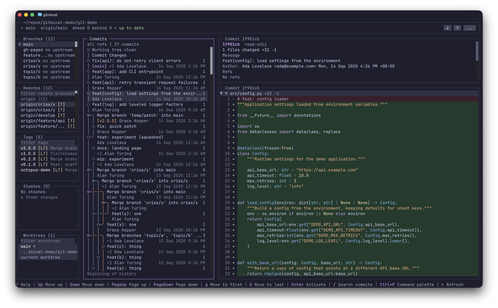

# Gitminal

A keyboard-first terminal git client.



The screenshot above is the authoritative UI reference. The app must match it.

Requires [Bun](https://bun.sh/) 1.3.14 or later. Gitminal runs on Bun, so Bun must be installed even when the package is installed through npm.

## Install

```bash
bunx @im4all/gitminal          # run without installing
bun add -g @im4all/gitminal    # install the `gitminal` command globally
npm install -g @im4all/gitminal
```

Then run `gitminal` inside any git repository.

## Configuration

Gitminal reads an optional `config.json`. The loader checks `$GITMINAL_CONFIG`, then `$XDG_CONFIG_HOME/gitminal/config.json`, then `~/.config/gitminal/config.json`, and finally `%APPDATA%\gitminal\config.json` on Windows. `keybindings.json` and `theme.json` sit next to it unless `$GITMINAL_KEYBINDINGS` or `$GITMINAL_THEME` overrides them.

Every key is optional. An invalid field keeps the previous effective value and adds a warning; unknown fields and safety settings are reported and ignored.

```json
{
  "version": 1,
  "git": { "path": "git" },
  "theme": "catppuccin-mocha",
  "ui": { "mouse": true },
  "graph": {
    "scope": "all",
    "initialPageSize": 500,
    "style": "rounded"
  },
  "diff": {
    "contextLines": 3,
    "expandFirstWorkingFile": true
  },
  "stash": { "includeUntrackedByDefault": false },
  "remote": { "fetchScope": "local" }
}
```

### `graph.style`

- `rounded` (default) draws lazygit's arc corners and the bullseye merge symbol. It needs full box-drawing coverage, which mainstream coding fonts have.
- `sharp` uses the WGL4 and CP437 safe sharp corner set, full line ends instead of half-line characters, and an ASCII `+` merge symbol. Use it when your font or terminal lacks the arc subset, or draws it with gaps.

Both styles assume the terminal renders ambiguous-width characters as one cell. If the graph looks double-width or misaligned, set your terminal's ambiguous-width option to `1` (for example iTerm2 "Treat ambiguous-width characters as double width" off, or WezTerm `treat_east_asian_ambiguous_width_as_wide = false`).

## Development

To install dependencies:

```bash
bun install
```

To run:

```bash
bun dev
```

To build the publishable bundle:

```bash
bun run build        # writes dist/index.js, a single-file Bun bundle with a bun shebang
```

To publish:

```bash
bun pm version patch     # bump the version and create a git tag
bun publish --dry-run    # confirm the tarball contents
bun publish              # prepublishOnly runs check:all and build first
```

The tarball contains only `dist/index.js`, `package.json`, `README.md`, and `LICENSE`. `@opentui/core` and `@opentui/react` stay external so OpenTUI's per-platform native optional dependencies install normally, so the published package is a source bundle and not a compiled binary. Publishing as `@im4all/gitminal` uses `publishConfig.access: public`.

To typecheck:

```bash
bun run typecheck
```

To lint, format, and run the architecture checks:

```bash
bun run check                  # Biome plus boundary, glyph, and structure checks
bun run check:all              # check, typecheck, and unit tests
bun run check:fix              # apply safe Biome fixes and formatting
bun run check:structure --strict # fail on planned paths too, for the v1 freeze
bun run lint                   # lint only
bun run format                 # format only
```

To check code health with [Fallow](https://fallow.tools/):

```bash
bun run audit        # dead code, complexity, duplication, and styling on changed files
```

`bun install` installs the [Husky](https://typicode.github.io/husky/) Git hooks. The pre-commit hook runs `fallow audit` against the merge base of the branch upstream, so commits that introduce dead code, duplication, or complex functions are blocked. Use `git commit --no-verify` only when you deliberately need to bypass it.

This project was created using `bun create tui`. [create-tui](https://github.com/msmps/create-tui) is the easiest way to get started with OpenTUI.

## License

MIT - see [LICENSE](LICENSE).
