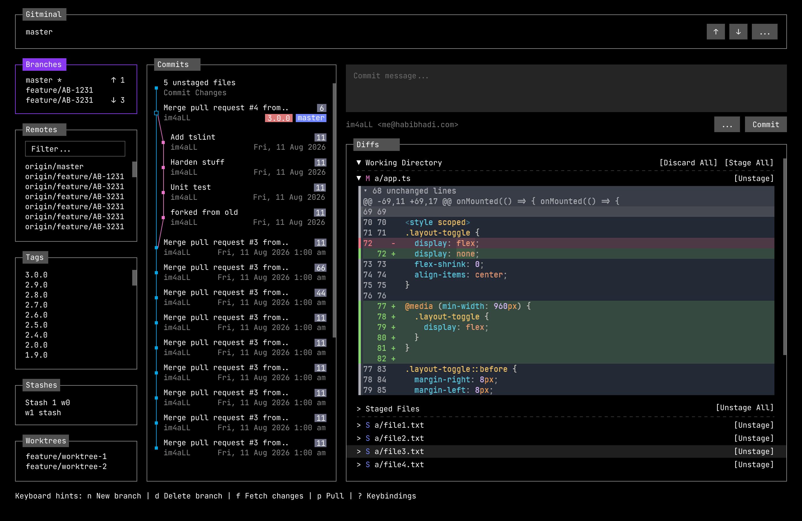

# 01 - App shell and focus

Status: Done (shell and focus frame; mouse row selection, double-click dispatch, quit confirmation, operation abort, loading rows, overlay footer keys, right-pane selection derivation, search/form input modes, and console provider ownership are deferred to later milestones as listed in section 2)

## 1. Header

Spec reference: `docs/product-spec.md` section 3 "Application shell" (lines 67-162), section 5 F-01 (lines 191-206), section 6 "Keyboard map" (lines 1539-1704), section 6.1 "Action IDs" (lines 1705-1742), section 9 "Resolved product decisions" (lines 1865-1889), and section 10 "Assumed defaults" (lines 1890-1908).
Dependencies: F-02 `02-top-bar.md`, F-03 `03-branches-panel.md`, F-04 `04-remotes-panel.md`, F-05 `05-tags-panel.md`, F-06 `06-stashes-panel.md`, F-07 `07-worktrees-panel.md`, F-08 `08-commit-graph.md`, F-09 `09-commit-composer.md`, F-10 `10-commit-details.md`, F-11 `11-diffs-and-file-actions.md`, F-13 `13-console.md`, F-15 `15-overlays-and-confirmations.md`, F-16 `16-repository-states.md`, F-19 `19-configuration-and-keybindings.md`, F-20 `20-theme-and-colors.md`, F-21 `21-startup-splash.md` (runs before this shell mounts).
Owned paths: `src/app/AppShellHost.tsx`, `src/features/shell/AppShell.tsx`, `src/features/shell/Sidebar.tsx`, `src/features/shell/SidebarPanelFrame.tsx`, `src/features/shell/SidebarSwitcher.tsx`, `src/features/shell/MainArea.tsx`, `src/features/shell/Footer.tsx`, `src/features/shell/Footer.constants.ts`, `src/features/shell/ResponsiveGate.tsx`, `src/features/shell/TooSmallNotice.tsx`, `src/features/shell/regions.ts`, `src/features/shell/focus.types.ts`, `src/features/shell/useFocusModel.ts`, `src/app/providers/FocusProvider.tsx`, `src/app/providers/StatusProvider.tsx`, `src/app/providers/StatusProvider.types.ts`, `src/app/hooks/useHotkeys.ts`, `src/app/hooks/useHotkeys.types.ts`, `src/app/hooks/useFocusRegion.ts`, `src/app/hooks/useFocusState.ts`, `src/app/hooks/useAction.ts`, `src/app/hooks/useAction.types.ts`, `src/app/hooks/useStatus.ts`, `src/ui/HintBar.tsx`, `src/ui/HintBar.types.ts`.
Consumed paths (not owned): `src/app/providers/KeymapProvider.tsx` (owned by F-19, read by `useHotkeys`, the footer, help, and the palette).

Visual reference: [`gitminal.png`](../../gitminal.png). This mockup is the authoritative UI target. The implemented shell must match it: the four-region frame, the three main columns, the sidebar panel stack and order, the top-bar control placement, the commit graph row layout, the right-pane split between composer or details and diffs, the diff styling and collapse marker, and the footer hint bar. Where this document does not settle a visual detail, the mockup wins. Behavior still follows `docs/product-spec.md`. The top bar middle shows branch info in the idle mockup state; at runtime it swaps to operation progress or transient status as specified in `02-top-bar.md`.



Mockup regions and their owning feature docs:

| Mockup area | Visual content | Owning doc |
| --- | --- | --- |
| Top bar | App name, current branch, up and down controls, More menu | `02-top-bar.md` |
| Sidebar, Branches | Local branch list with ahead and behind counts and selection marker | `03-branches-panel.md` |
| Sidebar, Remotes | Filter field and remote-tracking branch list | `04-remotes-panel.md` |
| Sidebar, Tags | Tag list | `05-tags-panel.md` |
| Sidebar, Stashes | Stash list with message and branch | `06-stashes-panel.md` |
| Sidebar, Worktrees | Worktree list | `07-worktrees-panel.md` |
| Commits column | Pending Changes row, graph lanes, nodes, ref badges, author, date, file count | `08-commit-graph.md` |
| Right pane, top | Commit message input, identity line, Commit button | `09-commit-composer.md` and `10-commit-details.md` |
| Right pane, Diffs | Working Directory, Staged Files, file headers, hunks, unchanged-line collapse | `11-diffs-and-file-actions.md` |
| Footer | Contextual keyboard hints | This document, section 8 |

This document follows the 14-section contract in `00-project-architecture.md` section 14 and conforms to the enforced structure in section 4, the component catalog in section 6, the focus model in section 8, and the state rules in section 9. Where this document and the architecture contract disagree, the architecture contract wins.

## 2. Scope and non-goals

In scope: the composition root `src/app/AppShellHost.tsx`; the four-region shell frame; the region focus state machine; initial focus on the top bar; Tab and Shift+Tab traversal order; the `1`-`9` direct region jumps and their action IDs; the focus border plus text marker; per-region cursor persistence; the responsive fallbacks at 100 columns, 90 columns, 80 columns, and 24 rows; the terminal-too-small notice using `ascii-font`; the contextual footer hint bar with priority-based dropping; mouse focus through native `autoFocus`; idle quit through `app.quit` with an interim refuse-while-running guard; and the single centralized keyboard dispatcher in `useHotkeys`.
Deferred to later milestones: mouse row selection, double-click dispatch, and wheel handling on rows (each owning panel feature); quit confirmation and operation abort (OverlayProvider and useCommandRunner); right-pane selection derivation (RepositoryProvider); loading rows, the "loading repository" status, and inline region errors (repository and feature milestones); overlay footer keys (OverlayProvider); `search` and `form` input modes (SearchField, FormField, and the overlay form work); and console provider ownership (ConsoleProvider). The deferred rows appear again in sections 7, 8, 9, 11, 12, and 13.
Non-goals: rendering the content of any panel, graph, composer, diff, or console (owned by F-03 through F-13); the startup splash and the npm update check (F-21 `21-startup-splash.md`); the overlay and modal stack plus destructive confirmations (F-15 `15-overlays-and-confirmations.md`); the keymap file format, defaults, and conflict detection (F-19 `19-configuration-and-keybindings.md`); theme token values and color capability (F-20 `20-theme-and-colors.md`); repository state detection and gating (F-16 `16-repository-states.md`); any git command execution.

## 3. OpenTUI components used

| Component | Where used | Why it is the right component |
| --- | --- | --- |
| `<box>` | AppShell root frame, Sidebar, MainArea, Footer, each region frame, the too-small notice container, and every mouse hit area. | The only layout, border, focus-ring, and hit-test primitive. Text is never rendered directly on a box. |
| `<text>` | Region titles, panel labels, footer hints and contextual reasons, selection markers, and the too-small notice body. | Every string of UI text goes through `<text>`. |
| `<span>` | Inline runs inside `<text>`: the key part of a `KeyHint`, the sync badge text, and marker emphasis. | Inline styling without a layout block. |
| `<scrollbox>` | The body of every sidebar panel and the main-area scroll regions; wheel scroll, scrollbars, and `viewportCulling`. | Handles wheel scrolling, visible-on-overflow scrollbars, and viewport culling for long lists. |
| `<tab-select>` | The collapsed single-panel switcher in `Sidebar` when the sidebar falls back below 90 columns. | Native horizontal selector semantics for switching the single visible sidebar panel. |
| `<ascii-font>` | The terminal-too-small splash, and the startup splash wordmark owned by F-21. | Splash text is the sanctioned use in architecture section 6. |
| `<select>` | Not owned here. The More menu lives in F-02. | N/A for this feature. |
| `<input>` | Not owned here. Filter fields live in the panels. | N/A for this feature. |
| `<diff>`, `<code>`, `<line-number>`, `<markdown>`, `<textarea>` | Not owned here. | N/A for this feature. |

OpenTUI hooks used:

| Hook | Where used | Note |
| --- | --- | --- |
| `useKeyboard` | Called exactly once, inside `src/app/hooks/useHotkeys.ts`. `src/app/SplashGate.tsx` owns the only subscription while the splash is visible. | Features never call `useKeyboard` directly. This is enforced by architecture section 6 and the boundary check in section 12. |
| `useOnResize` | Not used by M3. | `useTerminalDimensions` already re-renders on resize; a breakpoint-memoized resize hook is deferred until a measured need. |
| `useTerminalDimensions` | Drives the responsive layout mode in `ResponsiveGate`, minimum-size checks, sidebar width, and hint fitting budgets. | Single source for columns and rows. Every resize render recomputes the pure layout mode. |
| `useRenderer` | `AppShell` acquires initial focus on the top bar through `FocusProvider`; `AppShellHost` destroys the renderer on idle quit. | `App.tsx` owns only the splash quit callback. Feature components never call `destroy`. |
| `useFocus` / `useBlur` | Terminal-window focus and blur only. Refresh and pause work; never region focus. | Prevents background work while the terminal window is unfocused. |
| `useTimeline` | `Spinner` animation and throttled progress-bar redraws in the top bar status strip, owned by F-02. | Animation only. |
| `usePaste`, `useSelectionHandler` | Not owned here. | `usePaste` belongs to F-09; `useSelectionHandler` belongs to F-13. |

All icons and markers used by this feature come from `src/theme/icons.ts`; see architecture section 6.1. No glyph literal is written in feature code.

## 4. Component tree

```text
src/index.tsx (bootstrap: createCliRenderer with exitOnCtrlC: false + createRoot)
-> src/app/App.tsx
   -> SplashGate                          (while the splash is visible; owned by F-21)
      -> SplashScreen                     (src/features/splash/SplashScreen.tsx)
   -> (after dismissal) ConfigProvider
      -> ThemeProvider
         -> KeymapProvider
            -> RepositoryProvider
               -> DraftProvider
                  -> FocusProvider
                     -> OverlayProvider
                        -> StatusProvider
                           -> ConsoleProvider
                              -> AppShellHost              (src/app/AppShellHost.tsx, composition root)
                                 -> ResponsiveGate         (src/features/shell/ResponsiveGate.tsx)
                                    -> AppShell            (src/features/shell/AppShell.tsx, shells only)
                                       -> TopBar            (ReactNode prop from AppShellHost)
                                          -> TopBarStatus   (progress and transient status)
                                       -> Sidebar           (src/features/shell/Sidebar.tsx)
                                          -> tab-select     (collapsed switcher, conditionally)
                                          -> sidebarPanels  (ReactNode prop: BranchesPanel, RemotesPanel, TagsPanel, StashesPanel, WorktreesPanel)
                                       -> MainArea          (src/features/shell/MainArea.tsx)
                                          -> CommitGraph    (ReactNode prop)
                                          -> rightPane      (ReactNode prop: CommitComposer, CommitDetails, StashDetails, or WorktreeDetails)
                                          -> DiffPanel      (ReactNode prop)
                                       -> ConsoleDrawer     (ReactNode prop)
                                       -> Footer             (src/features/shell/Footer.tsx)
                                       -> overlayHost       (ReactNode prop: OverlayHost; it renders ConfirmModal and ErrorOverlay)
```

The tree shows the target composition. `RepositoryProvider`, `DraftProvider`, `OverlayProvider`, `ConsoleProvider`, and the feature surfaces are deferred; M3 mounts the configuration, theme, keymap, focus, and status providers with placeholder surfaces. `AppShellHost` is the only module that imports `features/shell` together with the feature panels, graph, composer, details, diff, console, and overlays. `AppShell` receives each feature surface as a `ReactNode` prop or child and never imports another feature. `Sidebar` and `MainArea` are shell components and receive the panels, graph, right-pane surface, and diff panel as children, so the feature-to-feature import ban holds at every level.

In M3 `AppShellHost` supplies placeholder surfaces. The right-pane derivation from `RepositoryProvider.selection` is deferred to the repository and main-workflow milestones: `pending` will render `CommitComposer`, `commit` `CommitDetails`, `stash` `StashDetails`, and `worktree` `WorktreeDetails`, while a `diffFile` selection leaves the current surface in place. No provider or feature will hold a separate sub-mode flag.

`ResponsiveGate` renders its children, the shell, or the terminal-too-small notice. Providers always mount so quit, help, and console remain reachable.

## 5. Enforced files and folders

| File | Responsibility |
| --- | --- |
| `src/app/AppShellHost.tsx` | Composition root and the only module that imports `features/shell` together with the feature surfaces. Supplies placeholder TopBar, sidebar panels, graph, right-pane surface, diff panel, and console to `AppShell`, and registers the global actions it owns once: `app.quit`, `overlay.close`, and `app.console`. Right-pane derivation, draft-aware quit, and abort are deferred. |
| `src/features/shell/AppShell.tsx` | Root frame: arranges TopBar, Sidebar, MainArea, ConsoleDrawer, Footer; owns the region frames and the mouse focus wiring; applies the layout mode from `ResponsiveGate`; focuses the top bar once on mount. It imports only shell components and receives every feature surface as a prop or child. |
| `src/features/shell/Sidebar.tsx` | Lays out the five sidebar panel children supplied by `AppShellHost`; renders the collapsed single-panel layout with the switcher. It never imports a panel feature. |
| `src/features/shell/SidebarPanelFrame.tsx` | Renders one focusable sidebar panel frame, its header marker, and its `<scrollbox>` container. The collapsed layout focuses this frame for keyboard entry; the switcher inside it stays focusable for mouse use. |
| `src/features/shell/SidebarSwitcher.tsx` | Renders the native `<tab-select>` for the collapsed sidebar, keeps its selected index in sync with a direct jump, and calls `refreshFocus` after a mouse-driven panel change. |
| `src/features/shell/MainArea.tsx` | Places the commit graph, right-pane surface, and diff panel children supplied by `AppShellHost`; defines the `graph`, `right-pane`, and `diff` region frames. It never imports a feature. The graph takes one third of the main-area width and the right column two thirds. The right column splits its height one part for the right-pane surface and four parts for the diff, so the diff holds about four fifths of the height at 40 rows, matching the mockup's roughly 1:4.2 split. One-cell gutters separate the graph from the right column and the right pane from the diff, and `AppShell` puts one cell between the sidebar and the main area; the mockup's wider spacing shrinks to one terminal cell because a wider gutter does not fit at 80x24. |
| `src/features/shell/Footer.tsx` | Renders the hint bar and priority-based hint dropping, including modal keys when `StatusProvider.hintMode` is `modal`. It reads `StatusProvider`, not `OverlayProvider`; the overlay wiring lands in M6. It does not render operation progress or transient status, which live in the top bar status strip owned by F-02. |
| `src/features/shell/Footer.constants.ts` | `MODAL_HINT_ACTIONS`: which action IDs and scopes the modal footer advertises. Labels come from `ACTION_BY_ID`. |
| `src/features/shell/ResponsiveGate.tsx` | Computes the layout mode from `useTerminalDimensions` and renders the shell children or the too-small notice. |
| `src/features/shell/TooSmallNotice.tsx` | Renders the terminal-too-small notice with the current size, the enforced `80x24` minimum, and the target `100x30` size, falling back to plain bold text below the wordmark thresholds. |
| `src/features/shell/regions.ts` | The stable region ID constants, Tab order, `focus.region.*` action map, responsive layout policy, `regionFrameId`, and `cursorKey`. The physical digit defaults live in `keymap.defaults.ts`. |
| `src/features/shell/focus.types.ts` | Type-only module: `RegionId`, `SidebarRegionId`, `FocusState`, `FocusContextValue`, `SidebarPanel`, `LayoutMode`, `ShellLayoutMode`, `RegionCursor`, `FocusModelOptions`, `FocusModel`, and `FocusRegionHandle`. It exports no runtime values. |
| `src/features/shell/useFocusModel.ts` | Computes the effective Tab order (skipping hidden regions), exposes `focusNext` and `focusPrevious`, applies the collapsed-sidebar panel selection, and then focuses the visible panel frame. Registers the `focus.region.*` handlers. The console jump opens the drawer through local shell state before focusing, and applies focus after the console region mounts. |
| `src/app/providers/FocusProvider.tsx` | Projects OpenTUI native focus: derives `activeRegion`, `textInputFocused`, `nativeListFocused`, `focusedRenderableId`, and `previousRegion` from renderer focus events; holds the per-region cursor map; exposes `focusRegion`, `focusRenderable`, `restoreFocus`, and cursor get/set. It has no writable `activeRegion` and no manual text-input flag. |
| `src/app/providers/KeymapProvider.tsx` | Owned by F-19. Holds the resolved action-to-keys map from `@/domain/keymap`; exposes lookups for `useHotkeys`, the footer, help, and the palette. |
| `src/app/providers/StatusProvider.tsx` | Holds transient status, footer hint mode, and operation progress; exposes `setStatus`, `clearStatus`, `beginOperation`, `updateOperation`, and `endOperation`. Both the top bar status strip and the footer hint bar read it. |
| `src/app/providers/StatusProvider.types.ts` | Status kinds, transient message, operation progress, footer hint mode, and the context value types used by the provider and `useStatus`. |
| `src/app/hooks/useHotkeys.ts` | The only `useKeyboard` caller. Resolves text input, native list widget, focused region, then global, and ignores a stale region when `focusInsideRegion` is false. It calls `preventDefault()` only for keys it handles. Overlay state is not wired yet. |
| `src/app/hooks/useHotkeys.types.ts` | `HotkeyResolutionInput` and `HotkeyResolution`, including the overlay inputs the pure resolver keeps for M6 and the `focusInsideRegion` gate. |
| `src/app/hooks/useFocusRegion.ts` | Returns `{ focused, focus(), regionProps, getCursor, setCursor }` for one region. `regionProps` supplies the stable id `region-<regionId>`, `focusable`, `borderColor`, and `focusedBorderColor`; `focused` is true when the focused renderable is the region frame or a descendant, including a text input inside it, and false while focus is in an overlay. |
| `src/app/hooks/useFocusState.ts` | Reads the derived focus projection and cursor helpers from `FocusProvider`. |
| `src/app/hooks/useAction.ts` | Exposes `useAction(actionId, { scope, targetKind, owner }, handler)`. Exactly one handler may exist per `(actionId, scope)`; a duplicate registration is rejected as a development error. Global actions are registered once by their designated owner, and features register only handlers scoped to their region. |
| `src/app/hooks/useAction.types.ts` | Action scope, owner, target kind, registration options, and handler types used by the registry and its consumers. `ActionScope` derives its region half from the shell's `RegionId` through a type-only import. |
| `src/app/hooks/useCommandRunner.ts` | App-layer command orchestrator owned by F-17: the only caller of `commands.runner.ts`; applies repository refresh, console append, status and progress, and error routing. Shell and feature handlers call this hook, never the domain runner. |
| `src/app/hooks/useStatus.ts` | Reads transient status and operation progress from `StatusProvider`. |
| `src/ui/HintBar.tsx` | Fits a single-line hint list by dropping and truncating hints. The footer supplies its hints and budget. |
| `src/ui/HintBar.types.ts` | Type-only `Hint` descriptor consumed by `HintBar` and the footer. |

## 6. State model

Provider state (architecture section 9): `FocusProvider` projects OpenTUI native focus into `activeRegion`, `textInputFocused`, `nativeListFocused`, `focusedRenderableId`, and `previousRegion`, and owns the per-region cursor map keyed by `RegionId`. OpenTUI remains the authority for which renderable receives keys; the provider never writes `activeRegion` from application code. `KeymapProvider` (owned by F-19) owns the resolved keymap. `StatusProvider` owns transient status, footer hint mode, and operation progress. `Footer` reads `StatusProvider.hintMode`; `OverlayProvider` is deferred to M6 and will own the modal stack that `useHotkeys` and `Footer` then read for precedence and modal hints. `RepositoryProvider` and `DraftProvider` are deferred to their milestones.

The right-pane sub-mode is derived, not stored, once `RepositoryProvider` lands: `AppShellHost` selects the surface from `RepositoryProvider.selection`: `pending` -> `CommitComposer`, `commit` -> `CommitDetails`, `stash` -> `StashDetails`, `worktree` -> `WorktreeDetails`. A `diffFile` selection leaves the current surface unchanged. No provider and no feature holds a separate sub-mode flag. M3 always renders the composer placeholder.

View state (local to shell components): the current `LayoutMode` (derived in `ResponsiveGate`, passed to `AppShell`), the active sidebar panel index when the sidebar is collapsed, and console drawer visibility until `ConsoleProvider` lands. `AppShell` also applies initial focus once on mount, on the `top-bar` region, so the shell has an active region and footer context before any key press. No shell component keeps a copy of repository state, keybindings, or theme tokens.

Cursor persistence: the cursor map lives in `FocusProvider`, not in each panel. A panel reads and writes its cursor through `useFocusRegion(regionId).getCursor` and `.setCursor`. When focus leaves and returns, the cursor is unchanged, satisfying "each list keeps its own cursor when focus moves away and back". Cursors are keyed by a stable item key (branch name, commit hash, file path) so a refresh that preserves the item also preserves the cursor.

## 7. Data flow

Focus change: key or click -> OpenTUI native focus changes -> `renderer` emits `focused_renderable` -> `FocusProvider` derives `activeRegion` and focus kind -> `useFocusRegion` consumers re-render, the region frame border updates natively, and `Footer` recomputes hints in the same render. `focus.next` does not write focus state; it calls `focusRegion(next)`, and the native event completes the loop. A direct jump follows the same path: digit -> `useHotkeys` -> the `focus.region.<id>` handler in `useFocusModel` -> `focusRegion(id)`. When the target is a sidebar panel that the collapsed layout is not showing, the handler first selects that panel in the `<tab-select>` and then focuses the newly visible panel frame.

Right-pane mode (deferred to the repository and main-workflow milestones): a selection change in `RepositoryProvider` -> `AppShellHost` reads `selection.kind` -> selects the composer, commit details, stash details, or worktree details node -> `MainArea` renders it inside the `right-pane` region frame. A `diffFile` selection does not change the node. No feature stores or toggles a sub-mode.

Key dispatch: physical key -> `useHotkeys` (the only `useKeyboard` caller) -> `@/domain/keymap/keymap.resolve.ts` resolves the action ID for the current context -> `useAction` selects the handler for the focused scope first, then the single global registration. Every handler is registered as `useAction(actionId, { scope, targetKind }, handler)`. Exactly one handler exists per `(actionId, scope)`, and a duplicate is rejected rather than last-mounted-wins. `AppShellHost` and the shell register each global action once; `remote.*` is owned once by the always-mounted top bar; features register only region-scoped handlers such as `branch.delete`, `remote.createLocal`, or `nav.activate`.

Refresh: action ID `app.refresh` -> the single global handler registered with `useAction` in `useRepository` -> `RepositoryProvider.refreshStatus()` -> `@/domain/git/git.repo.ts` and `git.status.ts` -> `git.client.ts` runs `git rev-parse --show-toplevel`, `git status --porcelain=v2 --branch -z --untracked-files=all`, and `git for-each-ref` -> parsers -> `RepositoryProvider` replaces the snapshot without touching the loaded graph window. Refresh is a read path and does not pass through `commands.runner.ts`.

Status (deferred to the repository and command milestones): every mutation handler calls `useCommandRunner.runCommand(request)` -> the orchestrator calls `StatusProvider.beginOperation` -> `git.progress.ts` publishes phase and percentage -> the orchestrator forwards them through `StatusProvider.updateOperation` -> `TopBarStatus` renders the phase text, `Spinner` or `ProgressBar`, and the percentage -> completion sets a transient success or warning status, appends one redacted console entry, and refreshes `RepositoryProvider`; a failure routes to `ErrorOverlay` plus a persistent status and still refreshes the repository. A cancelled or timed-out result sets a warning status, never success, and still refreshes.

Quit in M3: action ID `app.quit` -> the single global handler in `AppShellHost` destroys the renderer when no operation is marked as running. When `StatusProvider.operation` is non-null the handler shows a warning status and refuses to quit; this is an interim guard, not the final behavior. Confirmation and abort are deferred: once `DraftProvider`, `OverlayProvider`, and `useCommandRunner` land, the handler will read `hasUnsavedDraft` and the open confirmation, open `ConfirmModal`, abort a running operation through the `AbortSignal` owned by `useCommandRunner`, wait for `SIGTERM`/`SIGKILL` and child exit, and only then destroy the renderer. `useRenderer().destroy()` restores the terminal.

`Ctrl+C` is the hardcoded quit escape hatch. The renderer is created with `exitOnCtrlC: false`, so `Ctrl+C` is delivered as a key and dispatches `app.quit`; it is the one deliberate exception to text-input ownership and does not depend on the configurable keymap. In M3 it follows the same interim guard as `q`; in later milestones it follows the same confirmation and abort path.

No shell component calls git directly, and no feature or shell handler calls `commands.runner.ts` directly. Shell actions are limited to focus, refresh, quit, console toggle, help, palette, and theme picker. M3 registers the focus actions plus `app.quit` and `app.console`; the rest arrive with their feature docs. All mutation flows belong to their feature docs and dispatch through `useCommandRunner`.

## 8. Keyboard and focus

Action IDs only (product spec section 6.1). Raw key strings never appear outside `@/domain/keymap/**` and `src/app/hooks/useHotkeys.ts`.

| Context | Action IDs | Behavior |
| --- | --- | --- |
| Global | `focus.next`, `focus.previous` | Tab and Shift+Tab move between regions in the spec order, skipping regions hidden by a fallback. |
| Global | `focus.region.*` | Direct jump to one region (see below). |
| Global | `app.quit` | M3 destroys the renderer when idle and refuses with a warning while `StatusProvider.operation` is non-null. Confirmation and abort are deferred to M6; `Ctrl+C` dispatches the same action through the `exitOnCtrlC: false` renderer path and follows the same interim guard. |
| Global | `app.help`, `app.palette`, `app.console`, `app.refresh`, `app.themePicker`, `app.reloadConfig` | Cross-region actions each have exactly one designated owner in `src/app` or the shell. M3 registers `app.console` in `AppShellHost`; `app.help`, `app.palette`, `app.refresh`, `app.themePicker`, and `app.reloadConfig` arrive with their feature docs. Features do not register global actions. |
| Global | `overlay.close` | In M3, clears transient status and then returns focus to the owning region or `previousRegion` in the same press. Overlay closing and restoration join with `OverlayProvider` in M6. |
| Region | `nav.up`, `nav.down`, `nav.pageUp`, `nav.pageDown`, `nav.first`, `nav.last` | Move within the focused region. |
| Region | `nav.activate` | Primary action for the focused item. Mouse double-click dispatch is deferred to the panel features. |
| Sidebar (collapsed) | Native `<tab-select>` Left/Right | The focused `<tab-select>` switches the visible sidebar panel natively under native list mode; no app action ID binds these keys in a sidebar context. |
| Top bar | `nav.left`, `nav.right` | Move between top-bar controls (owned by F-02). |

Precedence implementation in `useHotkeys`: it calls `useKeyboard` once and, on each key event, resolves in this order, matching product spec section 3 and architecture section 8. OpenTUI runs global key listeners before the focused renderable's handler, so `preventDefault()` is what stops a focused input from also receiving a key that the app handled. The overlay branch is implemented in the pure resolver for M6 but is not wired by `useHotkeys` yet, because `OverlayProvider` does not exist. Once it lands, an open overlay owns the key. Outside a field, the only globals that may resolve are `overlay.close`, `app.quit`, and the toggle for that same overlay: `app.palette` when the palette is open and `app.help` when help is open. A modal text field keeps every plain unmodified key; only `overlay.close` on `Esc`, the hardcoded `Ctrl+C` quit path, and modifier-gated text-input-safe actions fire. No other global action, including `remote.*`, `app.themePicker`, or `app.reloadConfig`, is reachable until the overlay closes. The console drawer is not an overlay, so `app.console` remains global while it is open. Handled keys call `preventDefault()`. The overlay context applies the same text-input and native-list delegation for keys it does not handle, so modal fields still type and modal selects still navigate. Second, if a text input is focused, `Esc` leaves the input and normally returns focus to the owning region frame (a feature may consume the first `Esc` for a documented clear or cancel or define a different return target, but the next one leaves). `Tab` and `Shift+Tab` follow the field type first: a multiline `<textarea>` inserts the two-space indent unit at the cursor on `Tab` and removes up to one indent unit from the start of the current line on `Shift+Tab`, and neither moves focus, including inside an overlay; a single-line `<input>` moves to the next or previous region, or to the next or previous field or footer action inside an overlay. The textarea handlers call `insertText` or the line-edit API through the ref and then `preventDefault()`. `Enter` is not intercepted for a plain field: a single-line input handles it natively and emits its `onSubmit`/`onEnter` callback, while a textarea inserts a newline. M3 implements the `field` mode only: unmodified printable keys, Backspace, Delete, arrows, Home, End, and Enter stay with the editor, with Enter inserting a newline in a textarea and invoking native submit in a single-line input. `search` and `form` are deferred to `SearchField`, `FormField`, and the overlay form work. When they land, every focused editor will resolve to exactly one declared input mode; `search` keeps printable keys and editing keys in the field but routes Up, Down, PageUp, PageDown, Home, and End to the bound result list and Enter to `nav.activate`; `form` keeps printable keys and Enter in a single-line field, routes `Tab` and `Shift+Tab` between fields and footer actions, and maps `Ctrl/Cmd+Enter` to `form.submit`. A multiline form field keeps `Tab` for indentation and also uses `Ctrl/Cmd+Enter` for `form.submit`.

Only the text-input-safe app actions `app.palette`, `app.console`, `commit.submit`, `commit.options`, and `form.submit` may fire while typing. Each fires only when its effective binding uses `Ctrl`, `Cmd`, or `Alt`; an unmodified default binding for the same action never fires while an editor is focused. That is why `commit.options` is reachable as `Alt+.` in the composer while plain `.` types a period. Every other key, including all OpenTUI editing shortcuts and every configured app binding outside the allowlist, passes to the input untouched. `Ctrl+C` is the hardcoded quit exception from the product spec. Every other unmodified key is left untouched for the input and `useHotkeys` must not `preventDefault()` it. Third, if a native `<select>` or `<tab-select>` is focused, it owns `nav.up`, `nav.down`, `nav.pageUp`, `nav.pageDown`, `nav.first`, `nav.last`, and `nav.activate`; a focused `<tab-select>` also keeps Left and Right, which is how the collapsed sidebar switcher changes panels. `useHotkeys` does not consume those keys, but still handles `focus.next`, `focus.previous`, and modified shortcuts. Fourth, the focused region context is consulted. Fifth, global actions. Unhandled keys are ignored. `KeymapProvider` supplies the resolved map, `FocusProvider` supplies the active region and focus kind, and `useAction` supplies the handler registry. When `OverlayProvider` lands in M6 it supplies the overlay stack and the hook options that activate the pure overlay branch.

Splash keys: before the shell mounts, the splash gate in `src/app/App.tsx` owns the only keyboard subscription. Any key dismisses the splash and mounts the provider-backed shell; `Ctrl+C` quits. The splash is not a focus region, its keys are fixed, and it does not use action IDs because the keymap has not resolved yet. `useHotkeys` becomes the keyboard owner only after the splash gate unmounts. See `21-startup-splash.md`.

Collapsed sidebar switcher: when `LayoutMode` is `sidebar-collapsed`, `Sidebar` renders one `<tab-select>` whose options are the five panel labels and one panel body below it. Keyboard entry by `Tab` or by a `focus.region.*` digit jump focuses the visible panel frame, not the switcher, so the panel's region-scoped navigation keys work immediately. A jump to a hidden panel selects it in the `<tab-select>` and then focuses the newly visible frame. The switcher remains focusable and is the pointer-driven path: when it has focus, native list mode owns Left and Right and the selection changes natively; no app action binds those keys in a sidebar context and `nav.left`/`nav.right` are not registered by the sidebar. See section 14 for the ambiguity this resolves.

Direct region jumps: `regions.ts` maps each region to its `focus.region.*` action ID, `keymap.defaults.ts` binds `1`-`9` to those actions, and `useFocusModel` registers one handler per region. The digits follow screen order, not the Tab cycle, so the mapping reads like the mockup:

| Key | Action ID | Region |
| --- | --- | --- |
| `1` | `focus.region.branches` | Branches panel |
| `2` | `focus.region.remotes` | Remotes panel |
| `3` | `focus.region.tags` | Tags panel |
| `4` | `focus.region.stashes` | Stashes panel |
| `5` | `focus.region.worktrees` | Worktrees panel |
| `6` | `focus.region.graph` | Commit graph |
| `7` | `focus.region.rightPane` | Right pane, composer or commit details |
| `8` | `focus.region.diff` | Diff panel |
| `9` | `focus.region.console` | Console drawer |

- The digits resolve in the global context, so they work in every region frame, including while the sidebar `<tab-select>` or another native list widget is focused. They do not fire in an overlay (the overlay owns keys) or in a text input (printable keys belong to the field), matching precedence rules 1 and 2.
- `focus.region.console` opens the drawer when it is closed and then focuses the console region after it mounts. `app.console` remains the toggle and close path.
- Jumping to the region that already has focus is a no-op. It never toggles, re-selects, or resets the cursor, selection, or scroll position.
- A jump to a sidebar panel while the layout is collapsed selects that panel in the `<tab-select>` and then focuses the visible panel frame, so `1`-`5` are the fastest path to a panel in the collapsed layout.
- A jump to `right-pane` focuses whichever sub-mode is active, composer or commit details.
- `focus.region.topBar` exists for configuration and the palette but has no default binding. The top bar stays on Tab, click, and `focus.next`/`focus.previous`.
- Direct jumps stay available while a git operation is running, because navigation remains usable.
- They add no footer hints. The Focus section in Help and the Focus category in the palette are the discovery surfaces, so the footer keeps its per-region budget.

Mouse: OpenTUI `autoFocus` owns focus on click, and that is the only mouse behavior this feature implements. Clicking a text input focuses that input and derives its region; clicking a row, button, or empty area focuses the nearest focusable ancestor, normally the region frame. Mouse row selection, double-click dispatch of `nav.activate`, and wheel handling on rows are deferred to the owning panel features; where a panel adds them, they must not call `focus()` or write `activeRegion`, because native focus follows the click. Wheel scrolling inside a `<scrollbox>` is the native default and is exercised by each scrollable feature, not by the shell. Mouse never exposes an action without a keybinding.

Focus visibility: each region frame is a focusable `<box>` with a stable `region-<id>`, `focusedBorderColor` from `useTokens()`, and a leading `>` text marker in its header via `TextMarker`. Because the frame is focusable, OpenTUI also applies the focused border when a descendant input has focus. Color is never the only signal.

## 9. Loading, empty, error, and disabled states

- Loading (deferred): once the repository and feature milestones land, the shell will render immediately with region frames and a `LoadingRow` inside each not-yet-loaded region, and the top bar status strip will show "loading repository" while `RepositoryProvider` performs its first read. M3 renders placeholder surfaces instead.
- Empty (deferred): handled per region by its owning feature (`EmptyState`). The shell always renders the frame so the layout does not shift.
- Error (deferred): a repository-level failure will render through `ErrorOverlay` (F-15) and leave the shell frame intact; region-level failures will render an inline `ErrorState` with Retry. Shell-level failures never blank the whole app.
- Disabled (deferred with overlays): when an overlay is open, `OverlayProvider` will capture and blur the previously focused renderable, move native focus into the modal, and `useHotkeys` will route every key to the overlay, including digits. The only exceptions will be `overlay.close`, `app.quit`, and the same overlay's toggle (`app.palette` for the palette and `app.help` for help). Background regions will be visibly inactive (dim tokens). When an operation is running, the top bar status strip shows the phase and progress while the footer keeps the hint bar, because navigation, direct jumps, console, and help remain usable.
- Text markers: focus marker `>`, selection marker `>` from `TextMarker`, detached and missing-upstream markers `[?]` from their features, and status markers from `TextMarker`. No state is conveyed by color alone.
- Too small: below 80 columns or 24 rows, `ResponsiveGate` renders the `ascii-font` notice showing the current size, the enforced minimum `80x24`, and the target `100x30`, and does not attempt the layout.
- Splash: before the shell mounts, the startup splash renders the wordmark, version, and update notice, and waits for a key press. It never shows a loading state for the repository because no repository read has started. See `21-startup-splash.md`.

## 10. Performance and bounds

- Focus changes must not remount region subtrees. Region frames are stable; only the border color and header marker change. Direct jumps use the same `focusRegion` path, so they inherit this bound.
- The footer hint bar never wraps. `Footer` computes a hint budget from `useTerminalDimensions` and drops the least important hints first, always keeping Help available.
- The top bar status strip has a fixed one-row height and a width budget computed by F-02. It never wraps and never changes the top bar height. Progress redraws are throttled to the renderer frame rate.
- The cursor map is a plain object keyed by region, so cursor reads are O(1) and do not trigger repository reads.
- `useTerminalDimensions` re-renders `ResponsiveGate` on resize; `resolveLayoutMode` is a pure O(1) call, so the gate does not hold a duplicate size state or a stale breakpoint memo. A dedicated breakpoint-memoized resize hook is deferred until profiling shows the re-render matters.
- The startup splash renders on the first frame and never waits on the npm update check; the check is bounded by its own timeout and is discarded on dismissal. See `21-startup-splash.md`.
- Region rendering stays bounded because each region's own virtualization is owned by its feature; the shell adds no unbounded list.

## 11. Safety and confirmations

- Quit confirmation is deferred to the OverlayProvider milestone. When it lands it will open when `StatusProvider` reports a running operation, `DraftProvider.hasUnsavedDraft` is true, or `OverlayProvider` has an open confirmation. The quit handler will never read draft state from the composer feature. The confirm modal will default focus to Cancel and use a specific label, not "OK". M3 does not open a confirmation and must not claim one exists.
- Operation abort is deferred to the same milestone. M3 refuses to quit while `StatusProvider.operation` is non-null and shows a warning. Later, after confirmation, `useCommandRunner` will abort the in-flight command through the `AbortSignal` passed to `git.client.ts`; the client sends `SIGTERM`, waits two seconds, then sends `SIGKILL`, waits for the child to exit, and only then destroys the renderer. A cancelled result is recorded as a warning, never as success.
- `Ctrl+C` uses the same `app.quit` handler. The renderer is created with `exitOnCtrlC: false`, so the key is not handled by the renderer, and the app owns the interim guard now and the confirmation, abort, and terminal-restore sequence later.
- `Esc` clears a transient status and then continues to the focus restore in the same press; it never discards staged files or a draft. With no transient status, it returns focus to the owning region when a text input is focused, otherwise to `previousRegion`. Overlay closing joins this path in M6. If a text input is focused, the text-input rule handles `Esc` first.
- The shell never performs a destructive git action itself, so it cannot bypass a feature's confirmation.
- Terminal restore is guaranteed on quit through `useRenderer().destroy()` after any child process has exited or been killed.
- Modal open state captures and blurs the background renderable, so a stray key cannot reach a background action and the region focus ring drops. On close, focus returns to the captured renderable or its region frame.

## 12. Acceptance mapping

| Product spec acceptance bullet | Implementing module or component |
| --- | --- |
| "Changing focus updates the highlighted region and the footer hints in the same render." (F-01 acceptance) | `src/app/providers/FocusProvider.tsx` deriving `activeRegion` from `focused_renderable`, `src/features/shell/useFocusModel.ts`, and `src/features/shell/Footer.tsx`. M3 recomputes hints on every focus change, but the visible set stays global-only until a panel registers region actions in M5/M7. |
| "Clicking a row selects it and focuses its region." (F-01 acceptance) | Region focus on click through OpenTUI `autoFocus` on the region frame is implemented and tested. Row selection is deferred to the owning panel features; when it lands, the row handler selects without calling `focus()` because native focus follows the click. M3 does not claim row selection. |
| "Keyboard navigation never requires a mouse." (F-01 acceptance) | `src/app/hooks/useHotkeys.ts` plus `src/app/hooks/useAction.ts`. |
| "The shell is persistent. Panels do not open as separate screens." (F-01) | `src/app/AppShellHost.tsx` composing `src/features/shell/AppShell.tsx` without feature-to-feature imports. |
| "Focus moves with Tab and Shift+Tab in this order unless an overlay is open..." (F-01) | `src/features/shell/regions.ts` order array and `src/features/shell/useFocusModel.ts` calling `focusRegion`. |
| "Focus order skips regions that are hidden by a responsive fallback." (F-01) | `src/features/shell/useFocusModel.ts` with the layout mode from `ResponsiveGate.tsx`. |
| "`1`-`9` focus the nine labeled regions directly, the top bar stays on Tab only, and no digit fires while a text input or an overlay owns keys." (v1 acceptance) | `regions.ts` focus action IDs, `keymap.defaults.ts` digit defaults, `useFocusModel.ts` `focus.region.*` handlers, and the `useHotkeys` precedence rules. |
| "The active region has a clear border and selection marker." (F-01) | Focusable region frames in `src/features/shell/AppShell.tsx` using `ui/Panel.tsx` with `focusedBorderColor`, plus `ui/TextMarker.tsx`. |
| "Each scrollable list shows a scrollbar only when content overflows." (F-01) | `<scrollbox>` usage in `src/features/shell/Sidebar.tsx`. |
| "The footer hint bar is always visible, including when a modal is open, where it shows the modal keys." (F-01) | `src/features/shell/Footer.tsx` renders always. M3 reads `StatusProvider.hintMode`; the `OverlayProvider` wiring is deferred to M6. M3 hints are global-only until the first panel registers region actions. |
| "Transient status does not permanently replace hints." (F-01) | `src/app/AppShellHost.tsx` shows status in the placeholder top bar and `src/app/providers/StatusProvider.tsx` owns it; the footer keeps its hints while status or progress is shown in the top bar. The real `TopBarStatus` arrives with F-02. |
| "The app remains usable at the target minimum size and shows a clear notice below it." (v1 acceptance) | `src/features/shell/ResponsiveGate.tsx`. |
| "Focus changes are visible and footer hints match the focused region." (v1 acceptance) | Native `focusedBorderColor` on focusable region frames plus `FocusProvider` derived `activeRegion` and `src/features/shell/Footer.tsx`. The per-region difference becomes observable when the first real panel registers its actions. |
| Selecting Pending Changes restores the composer; selecting a commit, stash, or worktree shows its details. (F-01, F-10, F-06, F-07) | Deferred: `src/app/AppShellHost.tsx` will derive the right-pane surface from `RepositoryProvider.selection`; no sub-mode flag will be stored. M3 renders the composer placeholder. |
| Quitting with an unsent commit message asks for confirmation. (section 3 lifecycle) | Deferred to the OverlayProvider and DraftProvider milestones. The future `app.quit` handler will read `DraftProvider.hasUnsavedDraft`; it will never import the composer. M3 only handles idle quit. |
| "The app restores the terminal before exit." (section 3 lifecycle) | M3 destroys the renderer on idle quit. Deferred: the future handler aborts any running child through the `useCommandRunner` signal, waits for exit, then calls `useRenderer().destroy()`; `exitOnCtrlC` is false and `Ctrl+C` dispatches `app.quit`. |
| "Launching the app shows the splash with the wordmark, the running version, and the press-any-key hint." (F-21) | `src/features/splash/SplashScreen.tsx` mounted by `SplashGate` in `src/app/SplashGate.tsx`. |
| "Pressing any key opens the workspace, and `Ctrl+C` quits." (F-21) | The any-key handler in `SplashGate` (`src/app/SplashGate.tsx`) using `src/app/quit.key.ts`; after dismissal `Ctrl+C` reaches `app.quit` through `useHotkeys`. |

## 13. Tests to add

- `src/features/shell/useFocusModel.test.tsx`: Tab order matches the spec order; hidden regions are skipped in each layout mode; `focus.next` wraps in both directions; every `focus.region.*` action focuses its region; `focus.region.console` opens a closed drawer before focusing it; a jump to the already-focused region changes nothing; a sidebar panel jump in the collapsed layout selects the panel and focuses its visible frame, and a region-scoped key then reaches its handler.
- `src/features/shell/regions.test.ts`: region IDs match the architecture section 8 list exactly, the Tab order array contains no duplicates, every region has exactly one `focus.region.*` action ID including `top-bar`, invalid collapsed panel indices clamp to exact orders, and `regionFrameId`/`cursorKey` are tested here rather than in the type module. The digit defaults are tested in F-19.
- `src/features/shell/ResponsiveGate.test.tsx`: 120x40 renders its shell children; 95x30 renders narrow sidebar; 85x30 renders the collapsed layout; 79x30 and 100x23 render the too-small notice with the current size, enforced `80x24` minimum, and target `100x30`.
- `src/features/shell/Footer.test.tsx`: the hint mechanism is covered with synthetic handlers. Hints reflect the focused region, a context override hides the shadowed global hint, focus leaving every region falls back to the global hints, hints drop in priority order as the width shrinks and Help stays, `focus.region.*` hints never appear, and modal keys replace region hints in `modal` hint mode. These are mechanism tests; M3 itself ships global-only hints because no panel registers a region action yet.
- `src/features/shell/AppShell.test.tsx`: rendering with `@opentui/react` test-utils asserts initial focus on `region-top-bar`, `Tab` and `Shift+Tab` traversal, focus marker movement, the target region after a digit jump, the focused renderable id after collapsed Tab entry and a collapsed digit jump, the native switcher selected index, the border color on native focus, click focus through `autoFocus`, and the right-pane/diff geometry (`region-diff` is at least three times the height of `region-right-pane`). The test renders `AppShell` with mock feature-surface props; `AppShell` never imports a feature.
- `src/app/hooks/useHotkeys.test.tsx`: the pure precedence table covers overlay-open, text-input focus, native list widget, region context, global, and the `focusInsideRegion` gate. Integration tests cover digits in a region frame, a focused editor keeping typing keys, textarea Tab indent and Shift+Tab outdent on a real `<textarea>` including the cursor position after outdent, `Enter` reaching a single-line input's `onSubmit` instead of `nav.activate`, OpenTUI editing keys passing through, and allowlisted actions firing only with a modifier. `search` and `form` routing is deferred with its UI.
- `src/app/providers/FocusProvider.test.tsx`: `activeRegion` derives from the focused renderable; focusing a text input inside a region keeps that region active; `textInputFocused` derives from `currentFocusedEditor`; `previousRegion` updates only on region changes; cursor survives a focus round trip; a frame id change leaves the projection stale until `refreshFocus` re-derives the new region. Overlay restore is deferred.
- `src/app/hooks/useFocusRegion.test.tsx`: `regionProps` sets a stable id `region-<regionId>`, `focusable`, and `focusedBorderColor`; `focus()` calls native focus; `focused` is true for the region frame and for a text input inside it, and false when focus is outside every region.
- `src/app/AppShellHost.test.tsx`: composes every placeholder surface inside the shell and registers every global action exactly once. An `Esc` press with a transient status clears it and restores `previousRegion` in the same press. Right-pane derivation is deferred with `RepositoryProvider`.
- `src/app/hooks/useAction.test.tsx`: accepts one handler per `(actionId, scope)`, rejects a duplicate registration instead of last-mounted-wins, resolves the focused scope before the global registration, and rejects a global registration from a component that is not a designated owner.
- `src/app/AppShellHost.quit.test.tsx`: idle `q` destroys the renderer once; a running operation shows the interim warning and does not destroy the renderer. Draft confirmation, abort, and the wait-for-exit sequence are deferred with their modules.
- `src/app/App.test.tsx`: the splash gate is the only keyboard subscriber while the splash is visible; the first key press dismisses the splash, mounts the shell, and unmounts the splash gate. Splash rendering tests live in `21-startup-splash.md`.

## 14. Open questions

- The product spec says the sidebar "collapses to a single active panel selected with Tab", while section 3 also defines Tab as region traversal. This document resolves it by keeping `focus.next` as region traversal, focusing the visible panel frame on keyboard entry, and using digits `1`-`5` for keyboard-only panel changes. The collapsed `<tab-select>` stays focusable for pointer-driven changes under native list mode; `nav.left` and `nav.right` are not bound in a sidebar context. Confirm that is acceptable, or define a distinct `sidebar.nextPanel` action ID.
- The exact collapse threshold is not specified beyond "below 100 columns". This document chooses 90 columns for the collapse and keeps the narrow-but-full layout between 90 and 99 columns. Confirm the threshold.
- Whether the too-small notice should still allow `app.quit` and `app.help` while blocking the layout is unspecified; this document keeps both available.
- Whether the sidebar width should shrink in fixed steps or proportionally between 90 and 99 columns is unspecified; this document uses a fixed narrow width.
